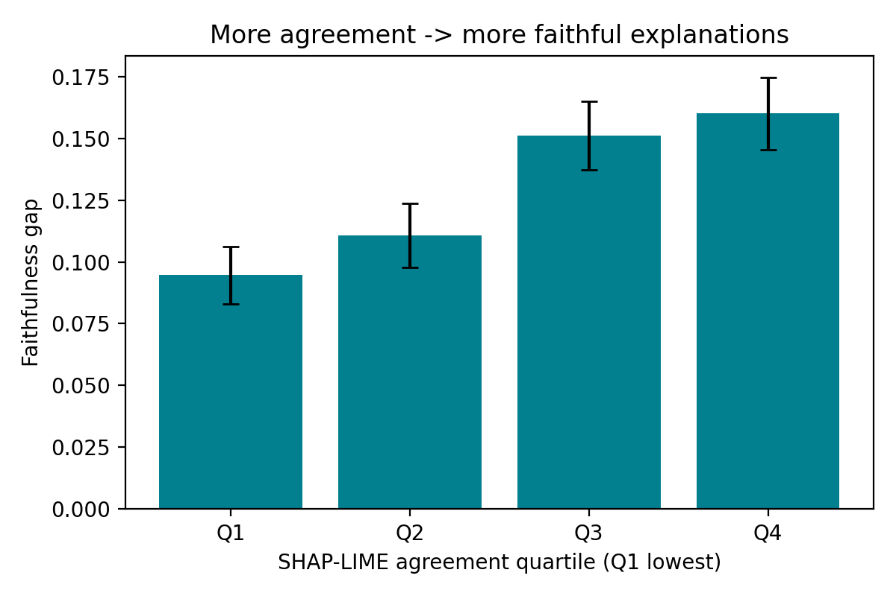
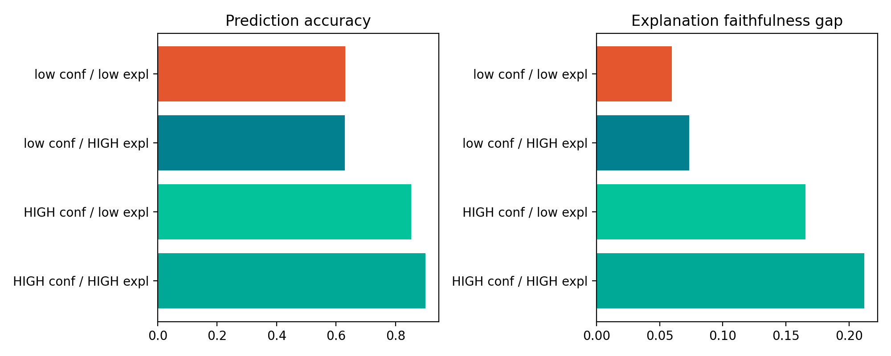
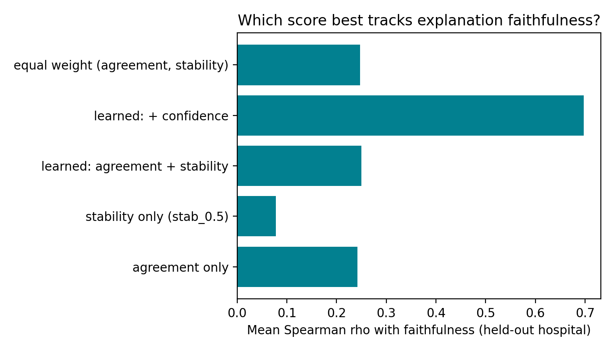

# TrustXAI-Med: Explainable AI with Quantitative Trust Scoring for Clinical Decision Support

A multi-hospital machine learning and Explainable AI (XAI) framework for heart disease prediction that evaluates **when clinical predictions and their post-hoc explanations actually deserve trust**.

Evaluated across **920 patients from four hospitals** (Cleveland, Hungarian, Switzerland, and VA) using a strict **Leave-One-Hospital-Out (LOHO)** protocol, this project pairs calibrated classifiers with **SHAP**, **LIME**, and **DiCE counterfactuals**, and statistically tests four per-patient trust signals across three model families.

---

## Key Findings

1. **Cross-hospital performance drops under prevalence shift:** A single-hospital prototype (Cleveland, 13 features) reached **90.2% accuracy**, whereas cross-hospital evaluation on unseen sites using 10 shared clinical predictors yields a more realistic **0.68–0.88 AUROC**. Probability calibration degrades sharply when disease prevalence shifts (e.g., `ECE ≈ 0.32` at Switzerland, 93.5% prevalence).
2. **Calibrated confidence is the dependable trust signal:** Calibrated confidence detects wrong predictions with **AUROC 0.667–0.687** across all three models. A blended trust score (`0.4·C + 0.3·A + 0.3·S₀.₀₅`) did **not** beat confidence alone (`0.673` vs. `0.687`, paired difference `−0.014`, 95% CI `[−0.029, +0.001]`).
3. **Explanation faithfulness depends on model confidence:** Faithfulness percentile `F₅` rises steadily from near-random (`0.56–0.59`) in the least confident quartile to `0.90–0.98` in the most confident quartile across Logistic Regression, Random Forest, and XGBoost.
4. **Agreement and stability add little beyond confidence:** An apparent SHAP–LIME agreement vs. faithfulness correlation (`ρ = 0.241` in Random Forest) shrinks to `ρ = 0.067` once calibrated confidence and hospital site are controlled for.

> **Practical Recommendation:** Always display calibrated prediction confidence next to every post-hoc explanation, and treat explanations of low-confidence predictions as hypotheses rather than clinical justifications.

---

## System Architecture & Methodology

* **Dataset:** UCI Heart Disease dataset (`920` patients across 4 institutions; binary target `num > 0`).
* **Leakage-Safe Pipeline:** Missing values (`?`, `-9`, and physiologically impossible `0` values for cholesterol and resting blood pressure) are imputed inside `scikit-learn` pipelines fitted strictly on training hospitals, alongside clinically motivated engineered features (`age_middle`, `age_senior`, `bp_hr_product`, `oldpeak_norm`, `risk_flags`).
* **Models & Calibration:** Logistic Regression, Random Forest, and XGBoost calibrated via 5-fold sigmoid (Platt) scaling (`CalibratedClassifierCV`).
* **Explainability Layer:**
  * **SHAP** (`TreeExplainer` / `LinearExplainer`) for exact local and global feature attributions.
  * **LIME** (`LimeTabularExplainer`) for local condition-based surrogate explanations.
  * **DiCE** for actionable counterfactuals restricted to clinically modifiable variables.
* **Quantitative Trust Signals:**
  * **Calibrated Confidence (C):** \(2\vert{}\hat{p}(x) - 0.5\vert{} \in [0, 1]\)
  * **SHAP–LIME Agreement (A):** Average of top-5 Jaccard overlap and Spearman rank correlation.
  * **Noise Stability (\(S_\sigma\)):** Explanation consistency across M=10 Gaussian-perturbed copies (\(\sigma \in \{0.05, 0.25, 0.50\}\)).
  * **Margin-Robust Faithfulness Percentile (\(F_k\)):** Share of R=50 random k-feature subsets beaten when removing the top-k explained features.

--

## Overview

SHAP and LIME are widely paired with clinical prediction models, but the **reliability of the explanations themselves** is rarely tested—especially on patients from hospitals unseen during training.

**TrustXAI-Med** builds a heart-disease prediction and explanation framework across **920 patients from four hospitals** and quantitatively evaluates **when a prediction and its explanation deserve trust**. For every patient, the framework computes four quantitative trust signals:

| Signal | Formula / Definition | Meaning |
|---|---|---|
| **Calibrated confidence (`C`)** | `C = 2·\|p̂ − 0.5\| ∈ [0, 1]` | How far the calibrated probability is from a coin flip |
| **SHAP–LIME agreement (`A`)** | Top-5 Jaccard overlap + Spearman rank correlation | Whether two independent explainers tell the same story |
| **Noise stability (`S_σ`)** | Mean similarity across `M = 10` noisy copies (`σ ∈ {0.05, 0.25, 0.50}` SD) | Whether SHAP explanations survive realistic measurement noise |
| **Faithfulness percentile (`F_k`)** | Share of `R = 50` random `k`-subsets beaten upon feature removal | Whether removing the top-`k` explained features drops confidence more than random removal |

These signals are validated using a **Leave-One-Hospital-Out (LOHO)** protocol, bootstrap confidence intervals (`1,000` resamples), and partial Spearman correlations.

---

## Research Questions

- **RQ1.** Can a score computed from the model and its explanations identify patients for whom the prediction is likely to be wrong?
- **RQ2.** Are SHAP and LIME explanations faithful to the model, and under what conditions do they cease to be so?
- **RQ3.** Do cross-method agreement and noise stability carry information beyond the model's own calibrated confidence?

---

## Project Phases

| Phase | Scope | Summary |
|---|---|---|
| **Phase 1** (Prototype) | Cleveland only (`303` patients, `13` predictors) | Logistic Regression & Random Forest, global/local SHAP, LIME, DiCE counterfactuals, and a hand-weighted composite trust score (`0.35·C + 0.30·A + 0.20·S + 0.15·P`) |
| **Phase 2** (Multi-Site Study) | 4 hospitals (`920` patients, `10` shared predictors) | `trustxai` package with LR, RF, and XGBoost, 5-fold sigmoid calibration, LOHO validation, per-patient trust signals, partial correlations, and 7 ablation studies |

---

## Dataset

[UCI Heart Disease Dataset](https://uci.edu) (Janosi, Steinbrunn, Pfisterer, & Detrano), 14-attribute processed files:

| Site | Source Institution | Patients | Disease Prevalence |
|---|---|---:|---:|
| **Cleveland** | Cleveland Clinic Foundation, USA | 303 | 45.9% |
| **Hungarian** | Hungarian Institute of Cardiology, Budapest | 294 | 36.1% |
| **Switzerland** | University Hospitals of Zurich and Basel | 123 | 93.5% |
| **VA** | V.A. Medical Center, Long Beach, USA | 200 | 74.5% |
| **Total** | **4 Hospitals** | **920** | **55.3%** |

- **Target:** Binary classification (`y = 1` if `num > 0`, else `0`).
- **Leakage-Safe Preprocessing:** Missing tokens (`?`, `-9`) and physiologically impossible `0` readings for `chol` and `trestbps` are imputed inside `scikit-learn` pipelines fitted strictly on training hospitals.
- **Shared Feature Set:** Because `ca`, `thal`, and `slope` are largely missing outside Cleveland, Phase 2 uses the 10 predictors recorded across all four hospitals (`age`, `sex`, `cp`, `trestbps`, `chol`, `fbs`, `restecg`, `thalach`, `exang`, `oldpeak`) plus 5 derived clinical features (`age_middle`, `age_senior`, `bp_hr_product`, `oldpeak_norm`, `risk_flags`).

---

## Selected Results

### Leave-One-Hospital-Out Performance (Random Forest)

| Held-out Hospital | Accuracy | F1 | AUROC [95% CI] | ECE |
|---|---:|---:|---:|---:|
| Cleveland | 0.752 | 0.749 | 0.861 [0.82, 0.90] | 0.084 |
| Hungarian | 0.793 | 0.734 | 0.874 [0.83, 0.92] | 0.117 |
| Switzerland | 0.659 | 0.784 | 0.765 [0.51, 0.97] | 0.325 |
| VA | 0.765 | 0.843 | 0.733 [0.63, 0.81] | 0.107 |

### Error-Detection AUROC & Faithfulness by Confidence Quartile

| Model | Confidence AUROC | Blended / Expl. Trust AUROC | Faithfulness `F₅` (Q1 Unsure) | Faithfulness `F₅` (Q4 Confident) |
|---|---:|---:|---:|---:|
| **Random Forest** | 0.687 | 0.673 (blend) / 0.526 (expl.) | 0.570 | 0.980 |
| **XGBoost** | 0.667 | 0.545 (expl.) | 0.560 | 0.899 |
| **Logistic Regression** | 0.680 | 0.505 (expl.) | 0.587 | 0.947 |

### Visual Summary (Random Forest, LOHO)

| Agreement vs. Faithfulness | Confidence × Explanation Quadrants | Learned Trust vs. Baselines |
| :---: | :---: | :---: |
|  |  |  |

*(Plots for Logistic Regression and XGBoost are located in `trustxai_pipelines/figures_logreg/` and `trustxai_pipelines/figures_xgb/`.)*

---

## Repository Structure

```text
TrustXAI-Med/
├── trustxai/                  # Full Phase 2 package & experiment runners
├── data/                  # UCI processed.*.data files (4 hospital sites)
├── data.py                # Multi-site data loading and cleaning
├── features.py            # Leakage-safe imputation & feature engineering
├── models.py              # LR, RF, XGBoost + 5-fold sigmoid calibration
├── evaluate.py            # CV, LOHO, Brier & ECE calibration metrics
├── trust.py               # Confidence, agreement, noise stability & blend
├── audit.py               # Feature-removal faithfulness audits
├── explain_trust.py       # Partial Spearman & quadrant validation
├── margin_faith.py        # Margin-robust faithfulness percentile (F_k)
├── analyze.py             # Statistical summaries & figure generation
└── run_*.py               # CLI runners for each experimental stage
├── figures_logreg/            # Logistic Regression evaluation figures
├── figures_rf/                # Random Forest evaluation figures
├── figures_xgb/               # XGBoost evaluation figures
└── *.csv                      # Saved per-patient audit & trust score outputs
└── README.md
```

---

## Installation & Usage

```bash
git clone https://github.com
cd TrustXAI-Med

python -m venv .venv
# Windows PowerShell:
.venv\Scripts\Activate.ps1
# macOS / Linux:
source .venv/bin/activate

pip install numpy pandas scipy scikit-learn xgboost shap lime dice-ml matplotlib seaborn joblib
```

Run the modular Phase 2 pipelines from `trustxai_pipelines/` (each runner saves per-patient CSV outputs so downstream statistics can be recomputed without re-running LIME):

```bash
cd trustxai_pipelines

# 1. Baseline models (5-fold CV and Leave-One-Hospital-Out)
python -m trustxai.run_baselines

# 2. Per-patient confidence, SHAP-LIME agreement, and noise stability
python -m trustxai.run_trust

# 3. Feature-removal faithfulness audit
python -m trustxai.run_audit

# 4. Margin-robust faithfulness percentile and statistical controls
python -m trustxai.run_margin_faith
python -m trustxai.run_explanation_trust
```

---

## Limitations & Future Work

- **Scope & Clinical Validation:** Evaluated on binary heart-disease prediction across 920 tabular records without clinician user studies.
- **Distribution Shift:** Strong prevalence differences across sites (36%–94%) degrade cross-site calibration at Switzerland and VA.


